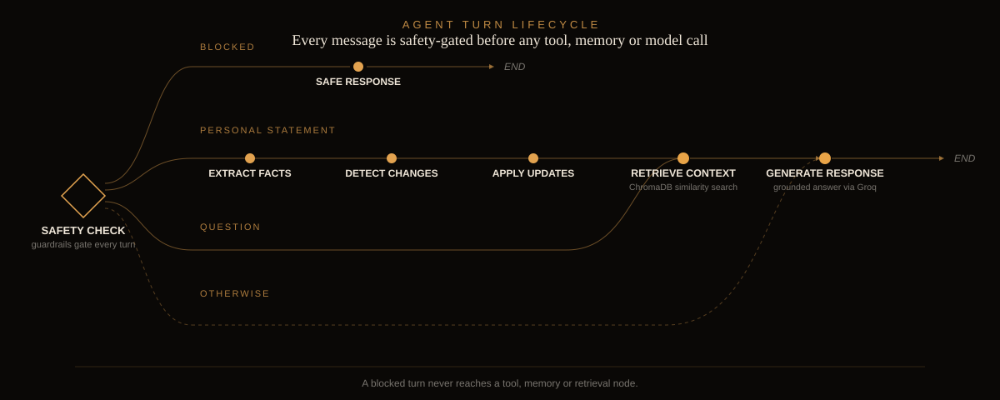
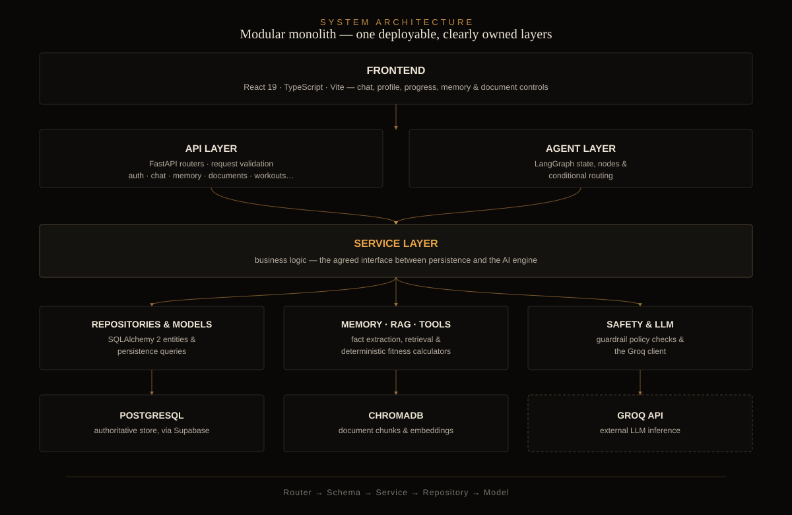

<div align="center">
  
</div>

<div align="center">


**[Key features](#key-features) · [How it works](#how-it-works) · [Architecture](#architecture) · [Tech stack](#technical-stack) · [Getting started](#getting-started) · [Deployment](#deployment) · [API](#api-overview)**

</div>

<br/>

## Overview

FitAI is a domain-specific, agentic RAG chatbot built for gym-goers, fitness enthusiasts, and nutrition-conscious users. It pairs retrieval-augmented generation over curated fitness and nutrition knowledge with persistent, structured user memory, deterministic fitness calculations, and a LangGraph-orchestrated agent — so every answer is grounded, personalized, and aware of what came before.

The system is built as a single, clearly-layered **modular monolith**: a React frontend talks to a FastAPI backend that coordinates authentication, persistence, memory, retrieval, fitness tools, safety policy, and LLM inference in one deployable application.

> FitAI offers general fitness and nutrition guidance. It is not a diagnostic or medical-treatment system.

## Key Features

| | |
|---|---|
| **Grounded chat** | Answers are grounded in retrieved knowledge, with sources surfaced directly in the UI. |
| **Persistent, structured memory** | Separates current facts from historical statements and asks for confirmation on ambiguous or conflicting updates. |
| **Cross-chat continuity** | Pinned core context, semantic recall of saved memories, and past-chat summaries carry earlier conversations into later ones. |
| **Deterministic fitness tools** | BMI, BMR, TDEE, calorie and macro targets, workout logging, personal-record detection, and progress analysis — computed, never guessed. |
| **Document ingestion** | Upload PDF, TXT, or DOCX (plus OCR for images); FitAI chunks, embeds, and indexes into ChromaDB with status tracking. |
| **Safety guardrails** | A deterministic rule set plus an optional LLM intent classifier gate every turn before any model or tool call — refusals never reach the model. |

## How It Works

Every user turn moves through a single LangGraph agent graph. Safety runs first and unconditionally — a blocked turn never reaches a tool, memory, or retrieval node. From there, the graph routes based on what the message actually needs: personal statements flow through fact extraction and memory update before any response; questions pull retrieved context first; everything else goes straight to a grounded response.

<div align="center">
  
</div>

| Node | Responsibility |
|---|---|
| `safety_check` | Deterministic rules plus an LLM intent classifier gate the turn before anything else runs. |
| `extract_facts` | Pulls structured, timestamped candidate facts out of personal statements. |
| `detect_changes` | Compares candidates against current memory and classifies them as current, historical, hypothetical, uncertain, or conflicting. |
| `apply_updates` | Persists only explicit, validated, high-confidence changes; ambiguous ones are proposed for user confirmation instead. |
| `retrieve_context` | Runs similarity search against ChromaDB for questions that need grounding. |
| `generate_response` | Produces the final, grounded reply through the Groq client. |

## Architecture

FitAI is a modular monolith, not a microservice mesh: one deployable application with clearly separated layers and an explicit dependency direction — **Router → Schema → Service → Repository → Model**. The AI engine (agent, memory, RAG, tools, LLM, safety) talks to persistence only through the same service layer the core backend uses; it never writes SQL or models directly.

<div align="center">
  
</div>

PostgreSQL, reached through Supabase, is the authoritative store for user profiles, conversations, memory, and fitness history. ChromaDB stores searchable document chunks and embeddings alongside it — it is never the source of truth for user data.

## Technical Stack

| Layer | Technologies |
|---|---|
| Frontend | React 19, TypeScript, Vite, Vitest, jsdom, React Router, react-markdown, Supabase JS |
| Backend | Python 3.10+, FastAPI, Pydantic 2, SQLAlchemy 2, Alembic, Uvicorn |
| Data & storage | PostgreSQL via Supabase, Supabase Auth, ChromaDB (vector store) |
| AI & retrieval | Groq (LLM inference), LangGraph (agent orchestration), ChromaDB embeddings |
| Tooling | Ruff, MyPy, Pytest, oxlint |

<details>
<summary><strong>Repository structure</strong></summary>

```text
FitAI/
├── frontend/                # React + TypeScript + Vite app
│   └── src/
│       ├── components/      # chat, layout, plan, progress, ui
│       ├── pages/           # Chat, Library, Memory, Plan, Profile, Progress, Documents, Login
│       ├── hooks/            # e.g. useConversations, useSpeechToText
│       ├── services/         # API client, Supabase, speech-to-text
│       ├── context/           # auth context
│       ├── types/              # shared TypeScript types
│       └── utils/
│
├── backend/                 # FastAPI app (modular monolith)
│   ├── app/
│   │   ├── main.py
│   │   ├── api/              # deps + routers
│   │   ├── schemas/           # Pydantic request/response models
│   │   ├── models/             # SQLAlchemy entities
│   │   ├── repositories/       # database access
│   │   ├── services/           # business logic
│   │   ├── agent/               # LangGraph state, nodes, routing
│   │   ├── memory/               # temporal reasoning, change detection, continuity
│   │   ├── extraction/           # structured fact extraction
│   │   ├── rag/                   # loading, chunking, embeddings, retrieval
│   │   ├── guardrails/            # deterministic rules + intent classifier
│   │   ├── tools/                  # fitness calculators and helpers
│   │   ├── llm/                     # Groq client + prompts
│   │   ├── safety/                  # policy checks
│   │   ├── stt/                      # speech-to-text service
│   │   ├── core/                      # config, security, logging, errors
│   │   └── db/                         # engine, session, base
│   ├── migrations/           # Alembic
│   └── tests/                 # unit, integration, api, end_to_end
│
├── docs/                     # setup, API contracts, extraction notes
├── knowledge_base/           # curated fitness/nutrition source documents
├── assets/readme/            # README visual assets
├── scripts/                  # dev, ingestion, and smoke-test utilities
├── AGENTS.MD                 # project conventions and ownership
└── README.md
```

</details>

## Getting Started

### Prerequisites

- **Python 3.10+** (developed against 3.13)
- **Node.js and npm** for the frontend
- A **Supabase** project for Auth (and optionally a private Storage bucket for documents)
- A **Groq API key** for LLM inference

### Backend

```powershell
cd backend
python -m venv .venv
# Windows (PowerShell)
.\.venv\Scripts\Activate.ps1
# macOS / Linux
source .venv/bin/activate

python -m pip install -e ".[dev]"

copy .env.example .env      # Windows; use `cp` on macOS/Linux, then fill in values
alembic upgrade head
uvicorn app.main:app --reload --host 127.0.0.1 --port 8000
```

- OpenAPI docs: `http://127.0.0.1:8000/docs`
- Liveness: `GET /health` · readiness: `GET /health/ready` (unauthenticated)

See [`docs/backend_setup.md`](docs/backend_setup.md) for the full environment runbook.

### Frontend

```bash
cd frontend
npm install
cp .env.example .env        # then fill in values
npm run dev
```

### Run both from the repository root

```bash
npm install        # installs the root dev dependency
npm run dev        # starts backend (:8000) and frontend (Vite) together
```

Convenience wrappers are also available: `scripts/dev.ps1` (Windows) and `scripts/run-all.sh` (macOS/Linux/Git Bash).

## Configuration

Environment variables are the single source of truth. Templates live in [`backend/.env.example`](backend/.env.example) and [`frontend/.env.example`](frontend/.env.example); real `.env` files are never committed.

Common backend variables (the full set is documented in [`docs/backend_setup.md`](docs/backend_setup.md)):

| Variable | Purpose |
|---|---|
| `DATABASE_URL` | PostgreSQL URL (`postgresql+psycopg2://...`, Supabase pooled). |
| `SUPABASE_URL` | Project URL; drives JWKS and expected issuer. |
| `SUPABASE_JWT_ALGORITHMS` | Token algorithm allow-list (`ES256,RS256` by default). |
| `SUPABASE_JWT_SECRET` | Only for legacy HS256 signing; left empty otherwise. |
| `GROQ_API_KEY` | LLM inference. |
| `BACKEND_HOST` / `BACKEND_PORT` | Dev server address used by the scripts and Vite proxy. |
| `CORS_ORIGINS` | Comma-separated allowed origins. |
| `DOCUMENT_STORAGE_BACKEND` | `unconfigured` / `local` / `supabase`. |

Frontend variables: `VITE_SUPABASE_URL`, `VITE_SUPABASE_ANON_KEY`, `VITE_API_BASE_URL` (defaults to `/api/v1`), and `VITE_STT_URL` (defaults to `/api/v1/stt`). Only the Supabase **anon** key belongs in the frontend; server-only secrets stay in the backend.

## Testing & Quality Checks

### Backend

```bash
cd backend
pytest                          # full suite
ruff check app tests            # lint
ruff format --check app tests   # formatting
mypy app                        # strict type checking
```

The backend suite runs against an in-memory SQLite database and overrides the auth dependency, so **no live Supabase or Groq credentials are required** for ordinary runs.

### Frontend

```bash
cd frontend
npm run type-check   # tsc -b
npm run lint         # oxlint
npm test             # vitest (jsdom)
npm run build        # production build
```

From the repository root: `npm run test:backend`, `npm run test:frontend`, `npm run type-check:frontend`, `npm run build:frontend`.

### Continuous integration

GitHub Actions runs on pull requests into `main` and on pushes to `main`:

- `.github/workflows/backend-ci.yml` — installs the backend with `uv`, then runs `ruff check`, `ruff format --check`, and `pytest` with no live credentials.
- `.github/workflows/frontend-ci.yml` — runs `npm ci`, `npm run lint`, `npm run type-check`, `npm test`, and `npm run build`.
- `.github/workflows/secret-scan.yml` — fails a pull request if a configured credential value appears in a changed file.

All three use `permissions: contents: read`, pin actions to commit SHAs, and inject no production secrets.
