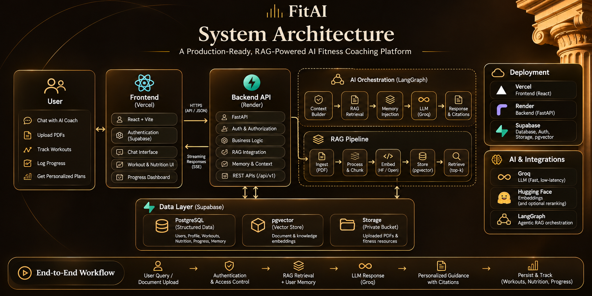
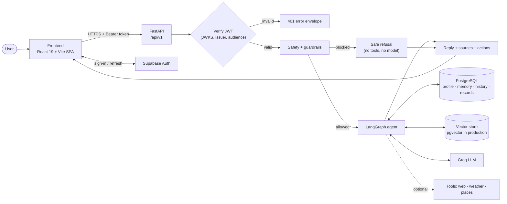
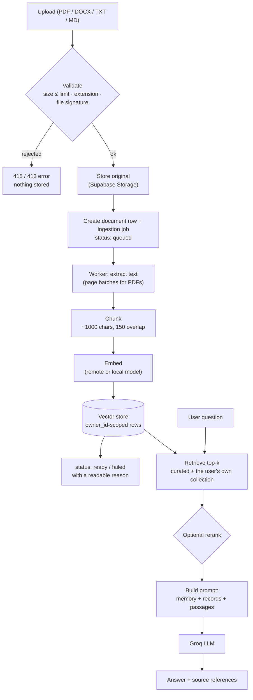
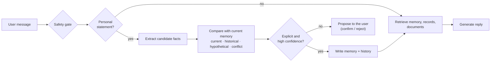

<p align="center">
  
</p>

<p align="center">
  
  
  
  
  
  
</p>

<p align="center">
  <b><a href="#overview">Overview</a></b> ·
  <b><a href="#key-features">Features</a></b> ·
  <b><a href="#product-showcase">Showcase</a></b> ·
  <b><a href="#system-architecture">Architecture</a></b> ·
  <b><a href="#rag-pipeline">RAG</a></b> ·
  <b><a href="#getting-started">Getting started</a></b> ·
  <b><a href="#deployment">Deployment</a></b> ·
  <b><a href="#api-reference">API</a></b>
</p>

---

## Overview

**FitAI is a conversational fitness coach for gym-goers, fitness enthusiasts and nutrition-conscious people.** Generic chatbots forget who you are and answer from a model's memory alone. FitAI is built to do the opposite: it remembers your profile and history, grounds its answers in retrieved documents, computes numbers deterministically, and shows where an answer came from.

It combines five things in one application:

| Capability | What it means in FitAI |
|---|---|
| **Conversational AI** | A LangGraph agent, backed by the Groq API, handles every chat turn. |
| **Retrieval-Augmented Generation** | Answers can draw on a shared curated knowledge base and on the user's own uploaded documents, and carry source references. |
| **Persistent personalization** | A structured profile and a fact-level memory (current vs. historical) carry context across conversations. |
| **Training and progress records** | Planned and logged workouts, body measurements and derived progress metrics live in PostgreSQL, not in the model. |
| **Deterministic tools** | BMI, BMR, TDEE, calorie and macro targets, one-rep-max estimates and trend analysis are calculated by code. |

They work together on each turn: safety checks run first, then the agent decides whether the message is a personal statement (extract and store facts), a question (retrieve context) or both, and finally generates a reply from your memory, your records, retrieved passages and any tool results.

> **Disclaimer.** FitAI provides general fitness and nutrition guidance. It is not a medical, diagnostic or treatment service, and its output can be wrong. Consult a qualified professional for medical advice.

## Key features

| Feature | What it does | How it works |
|---|---|---|
| **AI fitness coaching** | Training, nutrition and recovery conversations with history and search. | LangGraph agent ([`backend/app/agent`](backend/app/agent)) calling Groq ([`backend/app/llm`](backend/app/llm)). Responses are returned as a complete JSON reply (no token streaming). |
| **Workout planning and logging** | Plan sessions on a calendar, log what you did, apply templates, mark planned sessions complete. | `plan` and `workouts` routers over PostgreSQL; exercise library with global and per-user custom exercises. |
| **Progress tracking** | Weight, height, body fat, waist, sleep and steps series; BMI; training volume, streaks and personal records. | `progress` router and tools over stored measurements and sessions. |
| **Nutrition assistance** | Calorie targets, macro splits and nutrition Q&A grounded in your knowledge base. | Deterministic calculators ([`calculations.py`](backend/app/tools/calculations.py)) plus RAG. Meal-by-meal food logging is not implemented. |
| **RAG over documents** | Upload PDF, DOCX, TXT or Markdown and ask questions about them. | Validate, chunk, embed and index per user; see [RAG pipeline](#rag-pipeline). |
| **Source references** | Retrieved passages carry a source name and page; web-research answers list numbered sources. | `RetrievedChunk.citation()` and the `sources` array of the chat response. |
| **Persistent memory** | Durable facts about you (goals, preferences, injuries, routines) that you can review, correct and delete. | Extraction, change detection and confirmation flow; see [Memory](#memory-and-personalization). |
| **Cross-chat continuity** | Earlier conversations inform later ones. | Pinned core memory, semantic recall of memories and past-chat summaries, each with a per-user toggle. |
| **Safety guardrails** | Out-of-scope, unsafe and prompt-injection requests are stopped before any tool runs. | Deterministic rules plus an optional LLM intent classifier and an optional prompt-injection screen. |
| **Optional web and location tools** | Current information, weather, geocoding and nearby gyms. | Tool calls behind feature flags (`AGENT_WEB_TOOLS`, `AGENT_LOCATION_TOOLS`). |
| **Authentication and data isolation** | Each user only sees their own data. | Supabase Auth tokens verified server-side; every query scoped to the user; PostgreSQL Row Level Security as a second layer. |
| **Voice dictation** | Speak a message instead of typing. | Browser Web Speech API only; there is no speech backend ([`frontend/SPEECH_TO_TEXT.md`](frontend/SPEECH_TO_TEXT.md)). |

## Product showcase

Screenshots from the running application (demo account).

<table>
  <tr>
    <td width="50%" valign="top">
      
      <br /><sub><b>Landing page</b> — the public entry point, with sign-in and sign-up.</sub>
    </td>
    <td width="50%" valign="top">
      
      <br /><sub><b>Chat home</b> — conversation history, search, suggested prompts, attachments and voice dictation.</sub>
    </td>
  </tr>
  <tr>
    <td width="50%" valign="top">
      
      <br /><sub><b>Conversation</b> — a persisted chat thread in the serif-and-dark FitAI interface.</sub>
    </td>
    <td width="50%" valign="top">
      
      <br /><sub><b>Plan</b> — week, month and year calendar to plan sessions, mark rest days and log workouts.</sub>
    </td>
  </tr>
  <tr>
    <td colspan="2" valign="top">
      
      <br /><sub><b>Progress</b> — measurement series (weight, height, body fat, waist, sleep, steps, BMI) with training volume and streaks. The account shown is new, so the charts are empty.</sub>
    </td>
  </tr>
</table>

The application also includes **Library** (document upload and status), **Memory** (review, correct and delete what FitAI remembers) and **Profile / Settings** pages.

## System architecture

<p align="center">
  
</p>

<sub>Illustrative overview. The diagram shows a Vercel + Render split; the default Blueprint in this repository serves the frontend and API from one Render service (see [Deployment](#deployment)). Chat replies are returned as a single JSON response rather than streamed.</sub>

### Request flow



### Components

<details>
<summary><b>Frontend</b></summary>

- React 19, TypeScript, Vite, React Router, `react-markdown` with GFM, `@supabase/supabase-js`, `lucide-react`. Tests use Vitest, Testing Library and jsdom; linting uses oxlint.
- Pages: Landing, Login, Chat, Library, Memory, Plan, Progress, Profile/Settings ([`frontend/src/pages`](frontend/src/pages)). Secondary pages are lazy-loaded.
- Authentication: Supabase Auth in the browser; the access token is sent as `Authorization: Bearer …` to the backend, and a 401 response signs the user out ([`frontend/src/services`](frontend/src/services), [`context`](frontend/src/context)).
- API access goes through a single client against `VITE_API_BASE_URL` (default `/api/v1`, proxied by Vite in development). The browser never talks to the database directly.
</details>

<details>
<summary><b>Backend</b></summary>

- FastAPI with a layered modular monolith: **Router → Schema → Service → Repository → Model** ([`backend/app`](backend/app)). Pydantic 2 validates every input; SQLAlchemy 2 and Alembic handle persistence and migrations.
- Cross-cutting HTTP middleware: request IDs, a uniform JSON error envelope, security headers, CORS and rate limiting ([`core/service_app.py`](backend/app/core/service_app.py), [`core/http_security.py`](backend/app/core/http_security.py)).
- Authentication dependency verifies Supabase JWTs against the project's JWKS ([`core/security.py`](backend/app/core/security.py)); the user identity comes only from verified claims.
- The AI engine (agent, memory, RAG, tools, LLM, guardrails) reaches persistence through the same service layer as the rest of the backend.
- In production one process serves the API, the built frontend and an in-process, database-backed ingestion worker.
</details>

<details>
<summary><b>Data layer</b></summary>

- **PostgreSQL (Supabase)** is the source of truth for users, profiles, conversations, messages, memories and their history, documents and ingestion jobs, exercises, planned and logged workouts, measurements and activity events.
- **Vector storage** is selected by `VECTOR_STORE_BACKEND`: `pgvector` (table `vector_chunks`, PostgreSQL) in the production Blueprint, or embedded **ChromaDB** as the local-development default.
- **Document storage** holds the original uploads: a private Supabase Storage bucket in production (`DOCUMENT_STORAGE_BACKEND=supabase`), or the local filesystem in development.
- **Row Level Security** is enabled on every application table by migration `ca4d2c439416`. The API connects with a role that bypasses RLS, so ownership is additionally enforced in application code.
</details>

<details>
<summary><b>AI layer</b></summary>

- **LLM:** Groq, via the `groq` SDK. The model is set by `GROQ_MODEL` (the template uses `openai/gpt-oss-120b`). Separate, optional models can be set for routing, research, synthesis, summaries, structured extraction and the guard classifier.
- **Embeddings:** configurable. Local development defaults to a local sentence-transformers model (`all-MiniLM-L6-v2`, 384 dimensions). The production Blueprint uses a remote OpenAI-format embeddings endpoint (`Qwen/Qwen3-Embedding-0.6B` through the Hugging Face router, 1024 dimensions) and requires its own API key.
- **Reranking:** optional sentence-similarity reranking through Hugging Face (`HF_RERANKING_ENABLED`). It is **off by default and off in the Blueprint**; when disabled or failing, retrieval keeps vector-similarity order.
- **Orchestration:** LangGraph. A multi-agent router/research/synthesis path exists behind `AGENT_MULTI_AGENT`.
</details>

## RAG pipeline



1. **Upload.** `POST /api/v1/documents` accepts PDF, DOCX, TXT and Markdown up to `MAX_UPLOAD_SIZE_MB` (10 by default). Identical bytes uploaded twice by the same user return the existing item.
2. **Validation.** The extension is checked against the supported list and the content is verified against its claimed type (PDF/DOCX signatures; text files must not be binary) *before* anything is stored. Filenames are sanitised and storage keys are server-generated.
3. **Ingestion.** In production a database-backed job queue drives a worker inside the API process. Jobs are checkpointed in page batches, survive restarts, are retried a bounded number of times and end as `ready` or `failed` with a short, readable reason.
4. **Chunking.** Text is split on natural boundaries (paragraph, line, sentence, word) into roughly 1000-character chunks with 150 characters of overlap, keeping the page number for PDFs.
5. **Embedding and storage.** Chunks are embedded in batches and written to the vector store with an `owner_id`, document ID and embedding-model metadata. A dimension mismatch is rejected before it reaches the index.
6. **User-scoped retrieval.** For a question the retriever queries the shared `fitness_knowledge` collection (curated, visible to everyone) and the `user_documents` collection **filtered to the asking user**. Results below a minimum similarity (0.2) are dropped and duplicates removed; the top *k* (4 by default) are kept.
7. **Context construction.** Retrieved passages are added to the prompt alongside pinned memory, recalled continuity and your stored fitness context.
8. **Generation.** Groq produces the reply from that context.
9. **References.** Retrieved chunks carry `source` and `page`; research-style answers return numbered `sources` (title, URL, snippet) in the chat response.

Curated knowledge is ingested by an operator with `python -m scripts.ingest_knowledge` from files in [`knowledge_base/`](knowledge_base/README.md). This repository does not ship source documents.

## Memory and personalization

FitAI separates **structured data in PostgreSQL** from **vector-based recall**:

| Layer | Stored in | Used for |
|---|---|---|
| **Profile** | `user_profiles` (PostgreSQL) | Height, weight, goal, activity level, location, units. Editable on the Profile page. |
| **Memory facts** | `memories`, `memory_history` (PostgreSQL) | Durable facts with a key, value, timestamps and a current/historical distinction. |
| **Pending proposals** | `pending_memory_updates` | Ambiguous or conflicting changes wait for explicit confirmation. |
| **Records** | workouts, sets, planned sessions, measurements | Exact numbers answered from data, never guessed. |
| **Semantic recall** | vector store (`user_continuity`) | Finds relevant memories and past-chat summaries by meaning. |
| **Past-chat summaries** | `conversation_summaries` | Short summaries of earlier conversations. |



- A statement like *"I used to weigh 90 kg"* is recorded as history and does not overwrite the current value; hypotheticals are ignored.
- Structured extraction uses a dedicated, optional Groq key and model (`GROQ_EXTRACTION_*`). Without that key, extraction is disabled and chat works normally.
- Users can toggle memory recall and past-chat recall, and can edit or delete any memory from the Memory page. Deleted facts do not come back.
- Details: [`docs/extraction.md`](docs/extraction.md).

## Technology stack

| Area | Technologies |
|---|---|
| **Frontend** | React 19, TypeScript, Vite, React Router, react-markdown + remark-gfm, lucide-react |
| **Backend** | Python 3.10+, FastAPI, Uvicorn, Pydantic 2, SQLAlchemy 2, Alembic, structlog |
| **Database** | PostgreSQL (Supabase); SQLite is used only by the test suite |
| **AI / LLM** | Groq API (default model family `openai/gpt-oss`), LangGraph, LangChain Core |
| **RAG and embeddings** | pgvector (production) / ChromaDB (local default); remote embeddings (Qwen3-Embedding-0.6B via the Hugging Face router) or local sentence-transformers; optional Hugging Face reranking; pypdf, python-docx, RapidOCR for images |
| **Authentication** | Supabase Auth; JWT verification with PyJWT and JWKS |
| **Storage** | Supabase Storage (private bucket) or local filesystem |
| **Deployment** | Docker (multi-stage), Render, Vercel (optional split deployment) |
| **Development and testing** | Pytest, Ruff, MyPy, Vitest, Testing Library, oxlint, GitHub Actions |

## Repository structure

```text
FitAI/
├── frontend/                 React + TypeScript + Vite app
│   ├── src/pages/            Chat, Library, Memory, Plan, Progress, Profile, Login, Landing
│   ├── src/components/       chat, layout, plan, progress and shared UI
│   ├── src/services/         API client, Supabase client, speech helpers
│   ├── src/context/          auth context
│   └── vercel.json           headers and SPA rewrites for Vercel
├── backend/
│   ├── app/
│   │   ├── main.py           application entry point
│   │   ├── api/              dependencies and routers (/api/v1)
│   │   ├── schemas/          Pydantic request/response models
│   │   ├── services/         business logic (documents, ingestion jobs, workouts…)
│   │   ├── repositories/     database access
│   │   ├── models/           SQLAlchemy entities
│   │   ├── agent/            LangGraph state, nodes and routing (+ multi-agent path)
│   │   ├── memory/           change detection, confirmation, continuity, summaries
│   │   ├── extraction/       structured fact extraction and reconciliation
│   │   ├── rag/              loader, chunker, embeddings, vector stores, retriever, reranker
│   │   ├── guardrails/ safety/  intent classifier, deterministic rules, prompt guard
│   │   ├── tools/            calculators, workout/progress tools, web and location tools
│   │   ├── llm/              Groq client and prompts
│   │   └── core/             config, auth, logging, errors, HTTP security
│   ├── migrations/           Alembic migrations (including RLS)
│   ├── tests/                api, unit, integration, guardrails, security
│   └── Dockerfile*           backend images
├── Dockerfile.web            single-service image: built frontend + API
├── render.yaml               Render Blueprint (single web service)
├── render.split.yaml         Render Blueprint for the two-service layout
├── docs/                     setup, API contracts, deployment, extraction, security audit
├── knowledge_base/           drop-in folder for curated documents (see its README)
├── scripts/                  dev runners, ingestion and smoke-test utilities
└── .github/workflows/        backend, frontend, secret-scan and dependency-audit CI
```

## Getting started

### Prerequisites

- **Python 3.10+** and **Node.js 22** (the version used by the Docker build) with npm
- A **Supabase** project (Auth is required; a PostgreSQL database and, optionally, a private Storage bucket)
- A **Groq API key** for chat
- PostgreSQL reachable through `DATABASE_URL` (Supabase works; the local default expects `localhost:5432`)

### 1. Clone

```bash
git clone https://github.com/prnvvv/FitAI.git
cd FitAI
```

### 2. Backend

<details open>
<summary><b>Windows (PowerShell)</b></summary>

```powershell
cd backend
python -m venv .venv
.\.venv\Scripts\Activate.ps1
python -m pip install -e ".[dev]"
Copy-Item .env.example .env      # then edit .env
alembic upgrade head
uvicorn app.main:app --reload --host 127.0.0.1 --port 8000
```
</details>

<details>
<summary><b>macOS / Linux</b></summary>

```bash
cd backend
python -m venv .venv
source .venv/bin/activate
python -m pip install -e ".[dev]"
cp .env.example .env             # then edit .env
alembic upgrade head
uvicorn app.main:app --reload --host 127.0.0.1 --port 8000
```
</details>

At minimum set `DATABASE_URL`, `SUPABASE_URL` and `GROQ_API_KEY` in `backend/.env`. `uv sync --extra dev` (used by CI) is an equivalent way to install. The backend refuses to start if the database schema is behind the latest migration, so run `alembic upgrade head` first. See [`docs/backend_setup.md`](docs/backend_setup.md) for the full runbook.

### 3. Frontend

```bash
cd frontend
npm install
cp .env.example .env.local       # PowerShell: Copy-Item .env.example .env.local
npm run dev
```

Set `VITE_SUPABASE_URL` and `VITE_SUPABASE_ANON_KEY`. Leave `VITE_API_BASE_URL` unset in development: Vite proxies `/api/v1` to the backend.

### 4. Open the app

| URL | What |
|---|---|
| <http://127.0.0.1:5173> | Frontend (Vite dev server) |
| <http://127.0.0.1:8000/docs> | Interactive API docs (development only) |
| <http://127.0.0.1:8000/health> | Liveness probe |
| <http://127.0.0.1:8000/health/ready> | Readiness probe (checks the database) |

**Run both together** from the repository root: `npm install` then `npm run dev` (starts the backend on :8000 and the frontend). `scripts/dev.ps1` and `scripts/run-all.sh` are alternative wrappers.

## Environment configuration

[`backend/.env.example`](backend/.env.example) and [`frontend/.env.example`](frontend/.env.example) are the source of truth; each variable is commented there. **Real `.env` files are git-ignored. Never commit secrets.**

<details>
<summary><b>Backend variables (most important)</b></summary>

| Variable | Required | Secret? | Purpose / where to get it |
|---|---|---|---|
| `ENVIRONMENT` | yes | no | `development` or `production`. Production refuses to start with an unsafe configuration. |
| `DATABASE_URL` | yes | **yes** | PostgreSQL URL with the `postgresql+psycopg2://` driver (Supabase → Database → connection string, pooled). |
| `SUPABASE_URL` | yes | no | Supabase project URL; drives JWKS and the expected token issuer. |
| `SUPABASE_JWT_ALGORITHMS` | no | no | Accepted signing algorithms (default `ES256,RS256`). |
| `SUPABASE_JWT_SECRET` | no | **yes** | Only for legacy HS256 projects; leave empty otherwise. |
| `SUPABASE_SERVICE_ROLE_KEY` | with Supabase Storage | **yes** | Server-side only. Never expose to the frontend. |
| `GROQ_API_KEY` | yes (chat) | **yes** | [console.groq.com](https://console.groq.com). |
| `GROQ_MODEL` | no | no | Chat model id. |
| `GROQ_EXTRACTION_API_KEY` / `GROQ_EXTRACTION_MODEL` | no | key: **yes** | Dedicated memory-extraction model. Blank key disables extraction. |
| `CORS_ORIGINS` | yes (prod) | no | Comma-separated explicit `https://` origins. |
| `DOCUMENT_STORAGE_BACKEND` | for uploads | no | `unconfigured`, `local` or `supabase`. |
| `SUPABASE_STORAGE_BUCKET` | with `supabase` | no | Private bucket name (`fitai-documents`). |
| `VECTOR_STORE_BACKEND` | no | no | `chroma` (local default) or `pgvector`. |
| `EMBEDDING_PROVIDER`, `EMBEDDING_API_URL`, `EMBEDDING_API_KEY`, `EMBEDDING_REMOTE_MODEL`, `EMBEDDING_DIMENSION` | with `pgvector` | key: **yes** | Remote embeddings provider; the dimension must match the database column (1024 in production). |
| `HF_TOKEN`, `HF_RERANKING_ENABLED` | no | token: **yes** | Optional reranking (off by default). |
| `INGESTION_MODE` | no | no | `inline` (local) or `jobs` (durable queue used in production). |
| `GUARDRAILS_MODE`, `PROMPT_GUARD_API_KEY` | no | key: **yes** | Guardrail enforcement and optional prompt-injection screening. |
| `AGENT_WEB_TOOLS`, `AGENT_LOCATION_TOOLS`, `AGENT_MULTI_AGENT`, `SEARCH_PROVIDERS` | no | no | Feature flags and providers for optional tools (search provider keys are secret). |
| `RATE_LIMIT_*`, `TRUST_PROXY_HEADERS`, `EXPOSE_API_DOCS` | no | no | HTTP hardening; see [Security](#database-and-security). |

</details>

<details>
<summary><b>Frontend variables</b></summary>

| Variable | Required | Secret? | Purpose |
|---|---|---|---|
| `VITE_SUPABASE_URL` | yes | no (public) | Supabase project URL. |
| `VITE_SUPABASE_ANON_KEY` | yes | no (public by design) | Supabase anon / publishable key. Protected by Row Level Security. |
| `VITE_API_BASE_URL` | production split deploys | no | Backend URL including `/api/v1`. Defaults to `/api/v1`. |
| `VITE_DOCUMENTS_URL` | no | no | Only for a separate documents service. |

Everything prefixed `VITE_` is embedded in the browser bundle. **Never** put a service-role key or any other secret in a `VITE_` variable.
</details>

## Docker

[`Dockerfile.web`](Dockerfile.web) builds a **single image** containing the compiled frontend and the FastAPI backend. It runs as a non-root user, with one Uvicorn worker, and has a built-in health check. Run commands from the **repository root**.

```bash
# Build (the two VITE_ values are public and baked into the bundle)
docker build -f Dockerfile.web -t fitai-web:latest \
  --build-arg VITE_SUPABASE_URL=https://<project>.supabase.co \
  --build-arg VITE_SUPABASE_ANON_KEY=<anon-key> .

# Run (secrets come from an env file that is NOT committed)
docker run -d --name fitai-web -p 8000:8000 --env-file backend/.env fitai-web:latest

docker logs -f fitai-web                       # view logs
curl http://localhost:8000/health              # health check
docker inspect --format '{{.State.Health.Status}}' fitai-web
docker stop fitai-web && docker rm fitai-web   # stop and remove
```

- The container listens on `$PORT` (default `8000`); map it with `-p <host>:8000`.
- The image sets `ENVIRONMENT=production`, so the **production safety checks apply**: you need a PostgreSQL `DATABASE_URL`, an `https://` `CORS_ORIGINS` entry, `SUPABASE_URL`, `GROQ_API_KEY` and a valid storage and embeddings configuration. Override `ENVIRONMENT` only for throwaway local experiments.
- The image does **not** run migrations at start-up; apply them once beforehand: `alembic upgrade head` against the target database.
- `backend/Dockerfile` (with `docker-entrypoint.sh`) is an older backend-only image that does run migrations on start.

**Local Docker vs. production.** Locally you pass an env file and reach the container on `localhost`. In production the platform injects environment variables, terminates TLS, calls `/health`, and the database, Storage and vector data live in Supabase rather than in the container (the container filesystem is scratch space only).

## Deployment

### Default: one Render service

[`render.yaml`](render.yaml) deploys **one Docker web service** that serves the React app and the API from the same origin (no cross-origin CORS between them):

```text
Browser ──► Render (Docker: FastAPI + built frontend + in-process ingestion worker)
              ├─► Supabase  Postgres (+ pgvector), Auth, private Storage bucket
              ├─► Groq      chat and extraction
              └─► Remote embeddings provider (and optional Hugging Face reranking)
```

1. Create a Supabase project (Auth, Postgres, a **private** `fitai-documents` bucket) and apply the migrations once: `alembic upgrade head`.
2. Apply the Blueprint and set the variables marked `sync: false` (`DATABASE_URL`, `CORS_ORIGINS`, `SUPABASE_URL`, `SUPABASE_SERVICE_ROLE_KEY`, `GROQ_API_KEY`, embedding key, and the two public `VITE_` build values).
3. `CORS_ORIGINS` must be the service's own `https://` origin.
4. Health check path: `/health`. Auto-deploy is off by default.

### Optional: Vercel frontend + Render backend

[`frontend/vercel.json`](frontend/vercel.json) (SPA rewrites, caching and security headers) supports hosting the static frontend on Vercel. Set `VITE_SUPABASE_URL`, `VITE_SUPABASE_ANON_KEY` and `VITE_API_BASE_URL` (backend URL + `/api/v1`), and list the Vercel origin in the backend's `CORS_ORIGINS`. If the API is not on `*.onrender.com`, add its origin to `connect-src` in `vercel.json`. [`render.split.yaml`](render.split.yaml) describes the two-backend-service layout.

### Considerations

- **Single instance.** The image runs one worker; rate-limit counters and the ingestion worker are per-process. Do not scale horizontally without replacing the in-process limiter.
- **No persistent disk is required**: originals live in Supabase Storage, vectors and jobs in Postgres.
- **Free-tier cold starts** on Render add latency to the first request.
- Read [`docs/DEPLOYMENT_GUIDE.md`](docs/DEPLOYMENT_GUIDE.md) and [`backend/DEPLOYMENT_GUIDE.md`](backend/DEPLOYMENT_GUIDE.md) before the first deploy; the former describes the older ChromaDB-on-disk layout.

## API reference

All application routes live under **`/api/v1`**. Except for the health probes, every route requires `Authorization: Bearer <Supabase access token>`; an invalid or missing token returns `401` with the standard error envelope.

| Group | Prefix | Purpose |
|---|---|---|
| Auth | `/auth` | `GET /me` — identity from the verified token |
| Chat | `/chat` | `POST` a message, receive the reply |
| Conversations | `/conversations` | CRUD and paginated `/messages` |
| Profile | `/profile` | Read, replace (`PUT`) and update (`PATCH`) the profile |
| Memory | `/memory` | Facts, history, pending proposals with confirm / reject |
| Documents | `/documents` | Upload, list, rename, retry, delete |
| Plan | `/plan` | Planned sessions, day summary, templates |
| Workouts | `/workouts` | Logged sessions and sets |
| Progress | `/progress` | Measurements, series, BMI, derived metrics, records |
| Exercises | `/exercises` | Global and custom exercise library |
| Location | `/location` | Geocode and reverse geocode |
| Activity | `/activity` | Activity log |

Unprefixed: `GET /health`, `GET /health/ready`, `GET /health/guardrails`.

<details>
<summary><b>Example: send a chat message</b></summary>

```http
POST /api/v1/chat
Authorization: Bearer <access-token>
Content-Type: application/json

{ "message": "Help me plan my week", "conversation_id": null }
```

`message` is 1–4000 characters; `conversation_id` is optional (omit it to start a new conversation). The response contains `conversation_id`, `response`, `title`, `sources[]` (`index`, `title`, `url`, `snippet`), `actions[]` (for example a pending memory confirmation) and `tool_events[]`.

List endpoints return `{ "items": [], "total": 0, "limit": 20, "offset": 0 }` and accept `limit` (1–100) and `offset`.
</details>

Interactive docs are served at `/docs` in development and are **disabled in production** unless `EXPOSE_API_DOCS=true`. Contracts are summarized in [`docs/api_contracts.md`](docs/api_contracts.md).

## Database and security

- **Ownership.** Every user-owned row is scoped to the authenticated user in repository queries. Tables reached indirectly (messages, workout sets, planned exercises) are checked through their parent. Another user's resource returns `404`.
- **Row Level Security.** Enabled on all application tables, with owner policies and a deny policy for the anonymous role ([`backend/migrations/versions`](backend/migrations/versions)). It is defence in depth; the application enforces ownership itself.
- **Authentication.** Supabase Auth issues tokens; the backend verifies signature, issuer, audience and expiry with an algorithm allow-list. No passwords are handled by FitAI.
- **Documents.** Uploads are type- and content-validated, stored under server-generated keys in a private bucket, and retrieved only for their owner.
- **Transport and browser hardening.** HSTS, a Content-Security-Policy, framing and sniffing protection, and explicit CORS allow-lists.
- **Abuse protection.** Per-client rate limits on chat, uploads and other write paths; repeated failed authentication is throttled.
- **Secrets.** Provided only through environment variables; only the public Supabase anon key reaches the browser, and CI scans for committed credentials and for secrets in the built bundle.

Report vulnerabilities privately as described in [`SECURITY.md`](SECURITY.md). The full audit, residual risks and required platform settings are in [`docs/SECURITY_AUDIT.md`](docs/SECURITY_AUDIT.md).

## Testing and code quality

```bash
# Backend (from backend/)
python -m pytest -q                 # full suite; in-memory SQLite, no live credentials needed
ruff check .                        # lint
ruff format --check .               # formatting
mypy app                            # type checking (configured in pyproject.toml)

# Frontend (from frontend/)
npm run lint                        # oxlint
npm run type-check                  # tsc -b
npm test                            # vitest
npm run build                       # production build
npm run check:bundle                # scan dist/ for secrets and source maps
```

From the repository root: `npm run test:backend`, `npm run test:frontend`, `npm run type-check:frontend`, `npm run build:frontend`.

The backend suite mocks Groq and runs against an isolated in-memory database, so ordinary runs need **no Supabase, Groq or Hugging Face credentials**. A few tests that touch uploads expect `DOCUMENT_STORAGE_BACKEND=local` (CI sets it); PostgreSQL/pgvector integration tests are skipped unless a database is configured.

**Continuous integration** (GitHub Actions): backend lint + format + tests, frontend lint + type-check + tests + build + bundle scan, a committed-credential scan, and a weekly advisory dependency audit.

## Limitations and roadmap

**Current limitations**

- Pre-alpha software; interfaces and data models may still change.
- Chat responses are not streamed; a reply arrives when generation finishes.
- No meal-level food logging or nutrition database; nutrition support is calculators plus retrieval and chat.
- Answers can be wrong or incomplete and are not medical advice.
- Retrieval quality depends on the documents you provide; this repository does not ship a curated knowledge base.
- The production layout is a single instance with in-process rate limiting and ingestion.
- Reranking is optional and disabled by default.
- Some pinned AI libraries (LangGraph / LangChain Core) have known advisories awaiting a major upgrade; see the audit.
- No open-source license has been chosen yet.

**Possible improvements** (not implemented)

- Token streaming for chat.
- Shared rate-limit storage for multi-instance deployment.
- Upgrading the LangGraph / LangChain stack.
- Cookie-based sessions instead of browser-stored tokens.
- Food logging and richer nutrition data.

## Contributing

1. Read [`AGENTS.MD`](AGENTS.MD) for conventions and ownership boundaries.
2. Fork the repository and create a branch (for example `feat/<topic>`); do not work directly on `main`.
3. Keep changes small and focused, and add or update tests.
4. Run the backend and frontend checks listed above.
5. Open a pull request into `main` with a clear description and the checks you ran.

## License

No open-source license has been selected yet; `backend/pyproject.toml` lists the license as pending. Until one is added, no permission to reuse or redistribute the code is granted.

## Acknowledgements

Built with [FastAPI](https://fastapi.tiangolo.com), [React](https://react.dev), [Vite](https://vite.dev), [Supabase](https://supabase.com), [pgvector](https://github.com/pgvector/pgvector), [ChromaDB](https://www.trychroma.com), [LangGraph](https://www.langchain.com/langgraph), [Groq](https://groq.com), [Hugging Face](https://huggingface.co), [SQLAlchemy](https://www.sqlalchemy.org) and [Pydantic](https://docs.pydantic.dev). Hosted on [Render](https://render.com) and [Vercel](https://vercel.com).
